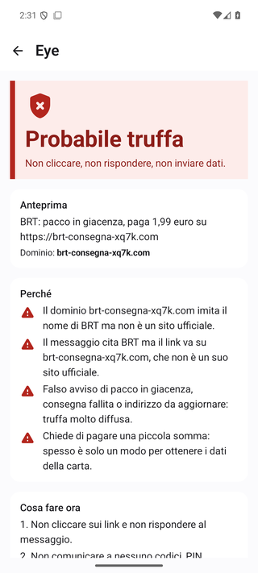
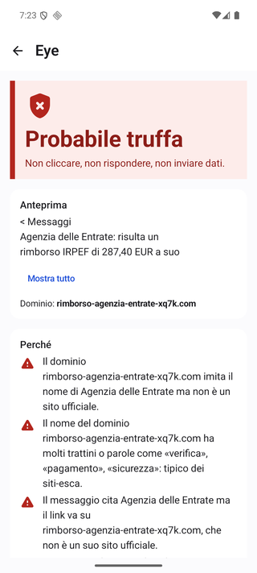
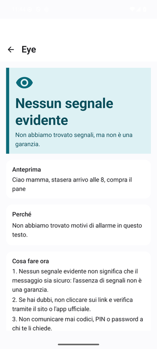
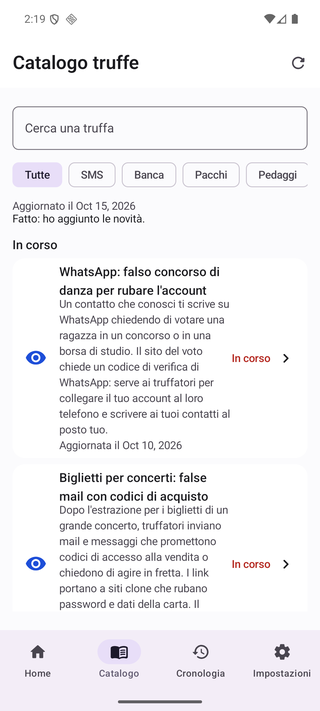

<p align="center">
  
</p>

<h1 align="center">Eye</h1>

<p align="center"><b>L'app anti-truffa gratuita e open source che controlla SMS, link, QR code e screenshot sul tuo telefono.</b><br>
<a href="https://eye.urielsec.com">Sito</a> · <a href="#compilare">Compilare</a> · <a href="#contribuire">Contribuire</a> · <a href="LICENSE">Apache 2.0</a></p>

Eye è un'app Android gratuita e open source che aiuta a riconoscere truffe e tentativi di phishing (SMS, messaggi, email, link, QR code, schermate) **senza inviare i tuoi contenuti a nessuno**: l'analisi avviene sul telefono.

Sito: https://eye.urielsec.com

## Funzioni
- Controllo manuale di testo incollato/condiviso, immagini (OCR sul dispositivo) e QR code, con verdetto e motivazioni comprensibili.
- Analisi automatica delle notifiche (facoltativa, scelta dall'utente).
- Regole aggiornabili con feed firmato e catalogo delle campagne in corso, con avvisi sulle nuove campagne (opt-in).
- Secondo parere AI facoltativo con chiave API propria (mai automatico, non modifica il verdetto delle regole).
- Cronologia locale con conservazione a scelta, analisi salvate, PDF per la denuncia, Modalità Famiglia, temi.

## Privacy
Nessun account, nessuna analitica, nessun permesso SMS o di accessibilità, nessuna lettura degli appunti in background. I contenuti analizzati restano sul dispositivo; la rete serve solo per scaricare regole e catalogo firmati. Vedi `docs/security/THREAT_MODEL.md`.

## Screenshot
<p align="center">
  
  
  
  
</p>

## Compilare
Requisiti: JDK 17+ (consigliato 21), Android SDK (compileSdk 36).

```
./gradlew :engine:test              # motore (JVM puro)
./gradlew :app:testDebugUnitTest
./gradlew :app:assembleDebug
```

La release firmata richiede un tuo keystore (`keystore.properties`, ignorato da git, oppure `-PeyeKeystoreProps` / variabile `EYE_KEYSTORE_PROPS`). Senza, la release resta non firmata.

## Struttura
- `:engine` — modulo Kotlin puro (nessuna dipendenza Android): estrazione, regole, punteggio, verifica firme dei pacchetti. Test JVM.
- `:app` — app Android (Jetpack Compose): UI, OCR, notifiche, cronologia, feed.
- `corpus/` — corpus sintetico e anonimizzato per valutare le regole.
- `tools/rulepack` e `tools/campaigns` — firma dei pacchetti regole e sorgente del catalogo campagne.

## Regole e feed firmati
Le regole sono in `engine/src/main/resources/rules/rules.json`. I pacchetti regole e il catalogo campagne sono firmati (Ed25519): l'app accetta solo pacchetti verificati con le chiavi pubbliche incluse nel motore (una attiva e una successiva) e con versione crescente. Formato e minacce: `docs/security/THREAT_MODEL.md`. Le chiavi di firma di produzione **non** sono in questo repo. Chi fa un fork deve generare le proprie chiavi (`tools/rulepack/README.md`), sostituire quelle pubbliche e cambiare `FEED_BASE_URL`.

## Contribuire
Leggi `CONTRIBUTING.md`. Nuove regole: modifica `rules.json` con test nel motore e casi nel corpus. Nuove campagne: `tools/campaigns/campaigns.json`. Mai dati reali: solo esempi sintetici e anonimizzati. Vulnerabilità: `SECURITY.md`.

## Licenza
Codice sotto licenza Apache-2.0 (vedi `LICENSE` e `NOTICE`). Il nome e il logo «Eye» **non** sono coperti dalla licenza: i fork devono usare un nome e un logo diversi.

---

## English (short)
Eye is a free, open-source Android anti-scam app. It checks messages, links, QR codes and screenshots **on-device**: no account, no analytics, no SMS/accessibility permissions. Rules and the campaign catalog are updated through signed feeds. Build with `./gradlew :engine:test :app:assembleDebug` (JDK 17+, Android SDK). `:engine` is pure Kotlin with JVM tests. Contributions are welcome (tests required, synthetic data only; see `CONTRIBUTING.md`). Production signing keys are not in the repo: forks must generate their own keys and change `FEED_BASE_URL`. Licensed under Apache-2.0; the "Eye" name and logo are not covered by the license. Website: https://eye.urielsec.com
